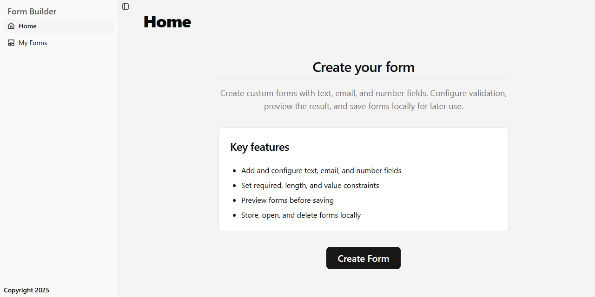
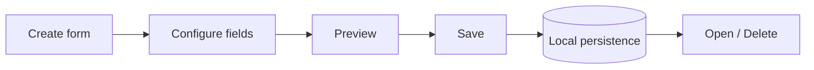

# Dynamic Form Builder

[](https://github.com/MarkupChef/dynamic-form-builder/actions/workflows/ci.yml)
[](LICENSE)

Dynamic form builder with configurable fields, live preview, runtime Zod validation, and local persistence.

**Live demo:** https://dynamic-form-builder-weld.vercel.app



## Features

- Add and configure text, email, and number fields
- Set required, length, and value constraints
- Preview a form before saving
- Store, open, and delete forms locally
- Keep builder progress across page reloads

## Tech Stack

- React 19, TypeScript, Vite
- Redux Toolkit and Redux Persist
- React Hook Form and Zod
- Tailwind CSS and shadcn/ui
- Vitest

## Getting Started

Requires Node.js 20.19+ or 22.12+ (see `.nvmrc`).

```bash
npm install
npm run dev
```

### Scripts

| Command             | Description                     |
| ------------------- | ------------------------------- |
| `npm run typecheck` | Type-check the project          |
| `npm run lint`      | Run ESLint                      |
| `npm test`          | Run unit tests                  |
| `npm run build`     | Type-check and build for production |
| `npm run preview`   | Preview the production build    |

## Key Architectural Decisions

- **Runtime Zod schemas.** Validation rules are generated from field definitions, so every saved form validates itself.
- **Discriminated unions for field props.** Field types narrow strictly, which avoids duplicated types and unsafe casts.
- **Redux Toolkit state.** One slice holds the form being built, another holds saved forms.
- **Local persistence.** Redux Persist stores state in the browser.
- **Name-based values.** Form values and schema keys use the configured field name, not the internal id.

## How It Works



## Limitations

- Data is stored locally in the browser only
- Three field types: text, email, and number
- Saved forms cannot be edited
- No backend, import/export, or collaboration

## License

[MIT](LICENSE)
